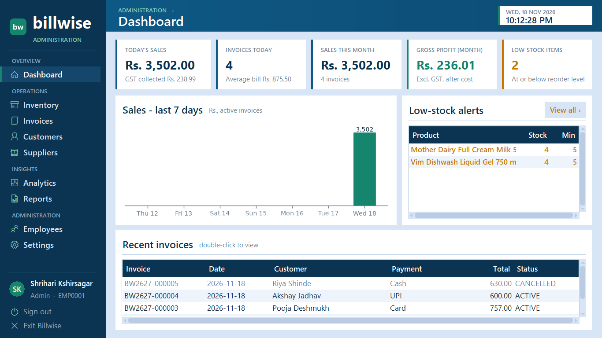
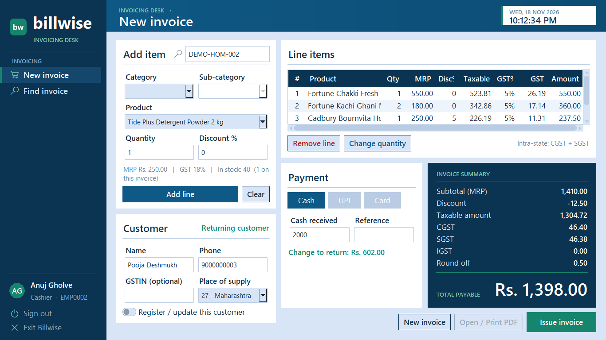
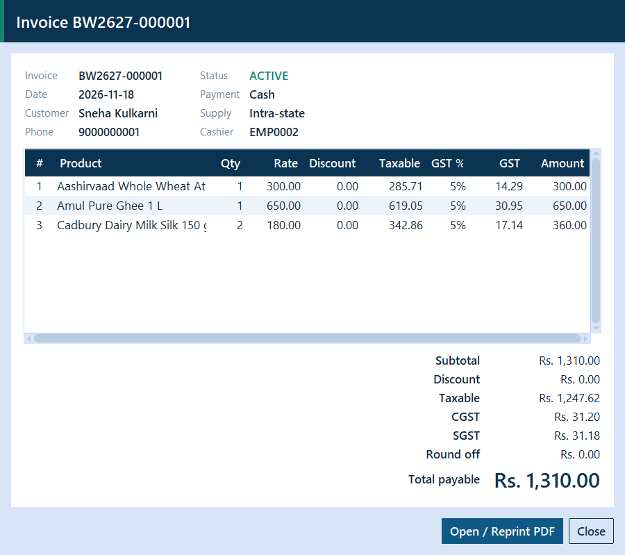
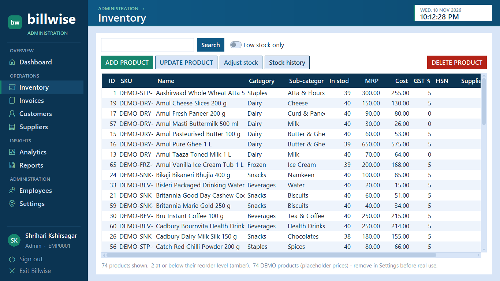
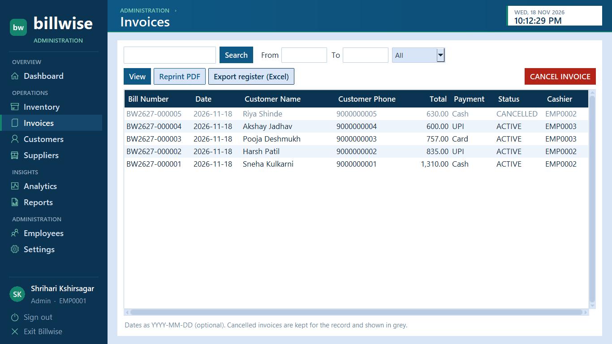
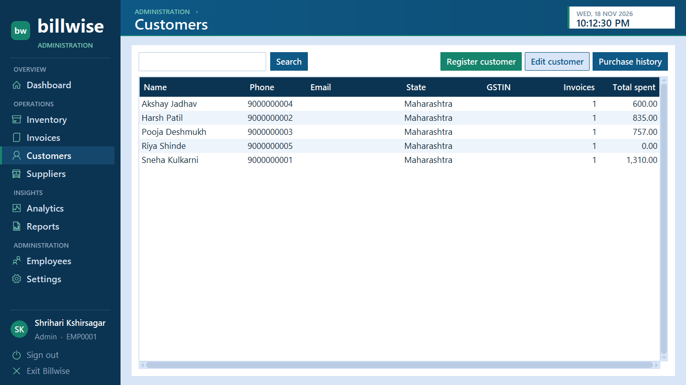
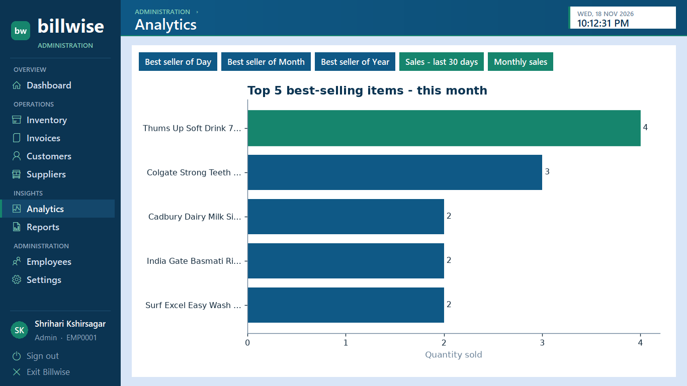
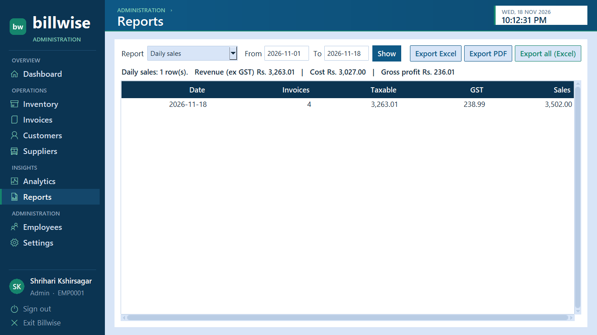
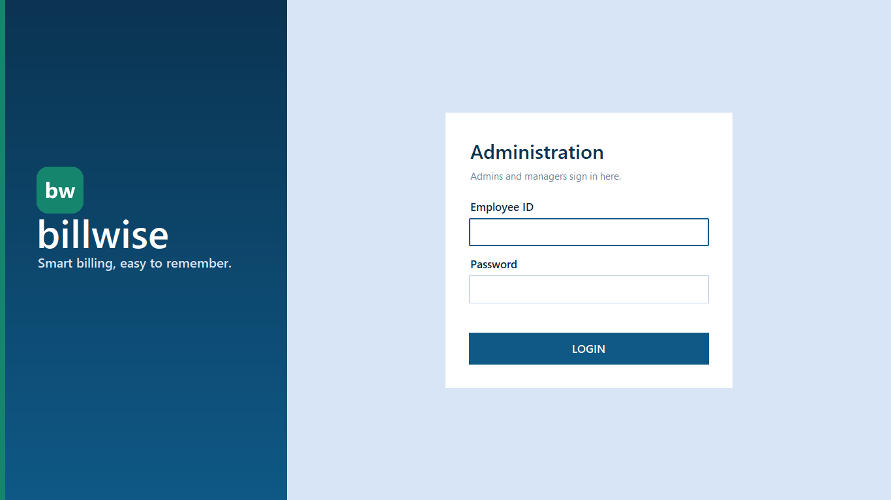

<h1 align="center">billwise</h1>
<p align="center"><b>Smart billing, easy to remember.</b></p>

<p align="center">
  
  
  
  
  
  
</p>

<p align="center">
  
</p>

Billwise is a desktop point-of-sale and inventory application for Indian retail
stores. It produces GST tax invoices (CGST + SGST or IGST), tracks stock with a
full movement history, and gives owners clear sales, profit and GST reports.
It is built with Python, Tkinter / ttkbootstrap and SQLite, and runs fully
offline on one computer.

## Highlights

**Billing counter**
- Quick search by product name, brand or SKU, or browse by category
- Cart merges repeated items and checks stock against the whole cart
- Per-line discounts and a GST rate stored on each product
- CGST + SGST or IGST chosen automatically from the place of supply
- Live bill summary with rupee round-off
- Cash (with change), UPI and card payments. For cards only the last 4 digits are stored.
- Sequential invoice numbers per financial year, for example `BW2627-000001`
- Each bill and its stock deduction are saved in a single transaction, so a failure leaves nothing half-saved
- Branded PDF tax invoice, invoice search, preview and reprint
- Returning customers are recognised by phone number

**Administration**
- Dashboard: today's and this month's sales, gross profit, 7-day sales chart, low-stock alerts, recent invoices
- Inventory with SKU, brand and pack size; stock adjustments (purchase, return, damage, correction) with movement history
- Employees with roles:
  - **Admin**: everything
  - **Manager**: no Employees or Settings
  - **Cashier** (any other designation): billing counter only
- Passwords are salted hashes and Aadhaar numbers are masked.
- Invoices: filter by text, date and status; view, reprint and export. Bills are cancelled (voided) rather than deleted, and their stock is returned.
- Customers with purchase history, and suppliers
- Analytics: best sellers for the day, month and year; daily and monthly sales
- Reports: daily and monthly sales, profit by product, best sellers, GST summary, invoice register, inventory valuation, low stock. Each exports to Excel or PDF.
- Settings: store details and state, default low-stock level, password change, database backup, demo catalogue

## Screenshots

| Invoicing desk | Invoice preview |
|---|---|
|  |  |
| **Inventory** | **Invoices** |
|  |  |
| **Customers** | **Analytics** |
|  |  |
| **Reports** | **Sign-in** |
|  |  |

Screenshots use test data for a sample store and the demo catalogue: prices are placeholders and phone numbers are dummy values.

## Billing rules

These rules live in `billing.py` and are unit-tested.

- Money is always `decimal.Decimal`.
- Product prices are MRP, inclusive of GST.
- Per line:
  - `gross = MRP × qty`
  - `discount = gross × discount% / 100` (rounded half-up)
  - `line total = gross − discount`
  - `GST = line total × rate / (100 + rate)` (rounded half-up)
  - `taxable = line total − GST`
- Intra-state: `CGST = GST / 2` (rounded half-up) and `SGST = GST − CGST`.
- Inter-state: `IGST = GST`.
- The grand total is rounded to the nearest rupee, and the difference is shown as **Round off**.
- Each invoice line stores its own price, rate, discount and tax, so past invoices never change when products are edited. The screen, the database and the PDF show the same stored figures, and a test checks this.

## Getting started

Requires Python 3.11+ (tested with Python 3.13 on Windows 10).

```powershell
python -m venv .venv
.venv\Scripts\activate
pip install -r requirements.txt
python main.py
```

1. `main.py` opens the launcher: **Billing counter** or **Administration**.
2. On the first start, Administration asks you to create the administrator account `EMP0000`. There is no default password. It also asks for the store's state, which decides CGST/SGST or IGST.
3. Add products, each with its GST rate, and employees. Then start billing.

The data lives in `Database/store.db` (SQLite). The app creates these folders as needed:
- `Invoices/`: PDF invoices
- `Reports/`: exports
- `backups/`: database backups
- `logs/`: error log

### Demo catalogue (optional)

*Administration → Settings → Load demo catalogue* adds 74 everyday products across staples, dairy, snacks, beverages, breakfast, frozen foods, personal care, health and wellness, home care, baby care and stationery. They carry recognisable brand names, `DEMO-` SKUs and pack sizes. You can also load it from the command line with `python demo_catalogue.py --load`.

Demo data is clearly marked:
- Every demo product is flagged **DEMO** in Inventory.
- **Prices are placeholders, not market prices.**
- GST rates are illustrative and must be verified before real use.
- No barcodes are included.
- Brand names only describe the products. Billwise is not affiliated with any brand or retailer.

*Remove demo products* (or `--remove`) deletes them again. Invoices that sold demo items keep their stored lines.

## Project structure

| File | Purpose |
|---|---|
| `main.py` | Launcher |
| `employee.py` | Billing counter |
| `admin.py` | Administration panel |
| `billing.py` | GST, discount, rounding and cart engine |
| `invoices.py` | Invoice creation (single transaction), search, cancellation |
| `inventory.py` | Products, stock adjustments, movement history, low stock |
| `people.py` | Employees and sign-in, customers, suppliers |
| `security.py` | Password hashing, roles, masking, validators |
| `reports.py` | Reports and Excel / PDF export |
| `invoice_pdf.py` | PDF tax invoice |
| `db.py` | Database location, connections, transactions, migrations, backups |
| `demo_catalogue.py` | Optional demonstration products |
| `theme.py` | The Billwise colour, typography and widget theme |
| `ui.py` | Shared widgets: sidebar, top bar, cards, tables, dialogs |
| `gst_states.py` | GST state codes |
| `tests/` | Unit, integration and GUI tests |
| `docs/screenshots/` | Images used in this README |
| `.github/` | Issue and pull-request templates, CI workflow that runs the tests |

## Tests

Tests always use temporary databases. They never open `Database/store.db`.

```powershell
pip install -r requirements-dev.txt
python -m unittest discover -s tests -t .
```

The GUI tests open hidden Tk windows, so run them on a desktop session.

## Design

| Role | Colour |
|---|---|
| Deep navy | `#0B3452` |
| Broadcast blue | `#0F5986` |
| Ice blue | `#D8E5F7` |
| Green | `#16856D` |
| White panels | `#FFFFFF` |
| Dark slate text | `#142B3D` |
| Blue-grey secondary text | `#6B8298` |
| Hover, hairline and zebra-row tints | `#14476B`, `#B9CCE4`, `#EEF4FC` |

Red is reserved for destructive actions and amber for low stock. Headings use Roboto Condensed when it is installed, otherwise Segoe UI. All styling is defined in `theme.py`.

## Contributing

See [CONTRIBUTING.md](CONTRIBUTING.md). Changes are listed in [CHANGELOG.md](CHANGELOG.md).
